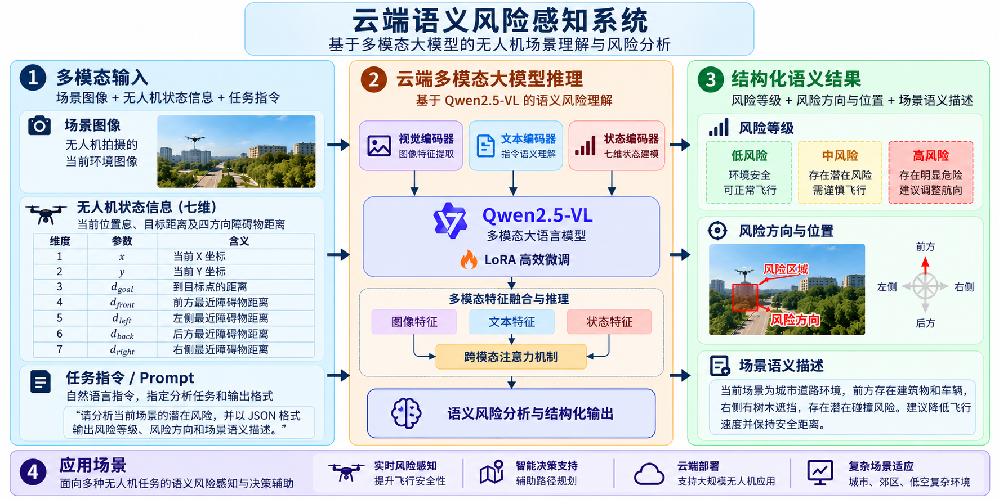

# Cloud-based Semantic Risk Perception reproduction

This repository contains the reproducible data, training, inference, and evaluation pipeline for cloud-based semantic risk perception with Qwen2.5-VL.

[](assets/system-overview-31a8cc9e.png)

*System overview. Click the image to view it at full resolution.*

The code is organized in the same order as the method in a paper:

```text
raw ODA/UAV data
    -> 1. data extraction and state annotation
    -> 2. multimodal instruction corpus
    -> 3. leakage-safe train/validation/test split
    -> 4. Qwen2.5-VL LoRA fine-tuning
    -> 5. single-image or JSONL inference
    -> 6. task-level and safety-oriented evaluation
```

The repository intentionally does not contain private datasets, downloaded model weights, checkpoints, or generated outputs. Put these files under the paths described below and keep them ignored by Git.

## 1. Repository map

| Directory | Paper role | Main output |
| --- | --- | --- |
| `pipeline/oda/` | Decode videos, align frames with OptiTrack state, and build obstacle metadata | Per-frame multimodal annotations |
| `pipeline/prepare_dataset.py` | Validate records, convert to MS-SWIFT format, and split data | `train.jsonl`, `val.jsonl`, `test.jsonl`, `dataset_summary.json` |
| `training/` | LoRA fine-tuning and monitoring | Adapter checkpoints and logs |
| `inference/` | Single-image, batch, state-conditioned inference, and comparisons | Prediction JSONL files |
| `scripts/` | Ascend environment setup and health checks | Reproducible runtime environment |
| `docs/` | Method, protocol, limitations, and paper reporting checklist | Experiment records and manuscript-ready definitions |
| `configs/` | Versioned experiment parameters | Explicit run configuration |
| `data/`, `models/`, `artifacts/` | Local-only inputs and outputs | Ignored by Git |

## 2. Environment

The original experiments used Ascend 910B with CANN 9.1.0. CUDA is also supported by `training/train.sh` and the inference scripts.

```bash
cd /path/to/Cloud-based-Semantic-Risk-Perception
bash scripts/setup_shj_env.sh
source scripts/activate_shj.sh
bash scripts/check_shj_env.sh
```

For another machine, set `SHJ_CONDA_EXE`, `ENV_NAME`, `CANN_ENV`, and the matching PyTorch/TorchNPU package sources before running the setup script.

## 3. End-to-end reproduction

### Step 1: Prepare the raw dataset

Place the extracted ODA dataset at `/path/to/ODA_full/dataset`, containing `trial_overview.csv` and trial directories. The raw data must stay outside Git. The dataset extraction stage groups all rows belonging to one trial, keeps multiple obstacles, aligns video timestamps with OptiTrack poses, and records skipped trials rather than silently dropping them.

```bash
python pipeline/oda/extract_multimodal_batch.py \
  --dataset-root /path/to/ODA_full/dataset \
  --output-root /path/to/multimodal_output \
  --workers 32
```

For a pilot subset, use `--trial-ids` or the list in `pipeline/oda/pilot_trials.txt`. Details and the expected manifest are in [`pipeline/oda/README.md`](../pipeline/oda/README.md).

### Step 2: Build the instruction corpus

The ODA corpus builder that creates task prompts is dataset-side code and should be recorded as an external dependency. Its output must contain image paths, `messages`, `trial_id`, `frame_index`, task names, label quality, and preferably a trial-level `split` field. Do not use frame-level random splitting when frames from the same trial are correlated.

### Step 3: Validate and convert the corpus

```bash
python pipeline/prepare_dataset.py \
  --input /path/to/vlm_training_corpus/oda_full/all.jsonl \
  --output-dir artifacts/prepared/oda_full
```

The script validates JSONL structure, `<image>` markers, image existence, message roles, and split integrity. If the input already has trial-level `split`, it uses that split. Otherwise it creates contiguous chronological frame groups per trial. To remove unreviewed pseudo-grounding labels:

```bash
python pipeline/prepare_dataset.py \
  --input /path/to/corpus/all.jsonl \
  --output-dir artifacts/prepared/oda_full_no_pseudo_grounding \
  --exclude-pseudo-grounding
```

### Step 4: Train the model

Download `Qwen2.5-VL-3B-Instruct` to `models/Qwen--Qwen2.5-VL-3B-Instruct`, or set `MODEL` to another local directory. Then run:

```bash
DATA_JSONL=/path/to/vlm_training_corpus/oda_full/all.jsonl \
MODEL=/path/to/Qwen2.5-VL-3B-Instruct \
PREPARED_DIR=$PWD/artifacts/prepared/oda_full \
OUTPUT_DIR=$PWD/artifacts/output/oda_full_6tasks \
ASCEND_RT_VISIBLE_DEVICES=4,5,6 \
NPROC_PER_NODE=3 \
NUM_EPOCHS=2 \
bash training/train.sh
```

The training script checks model shards, device availability, process/device count, dataset presence, and records the complete command output. The default method is Qwen2.5-VL with LoRA, frozen vision encoder, BF16, gradient checkpointing, cosine learning rate schedule, and trial-safe validation.

### Step 5: Run inference

Single-image inference:

```bash
python inference/infer.py \
  --model /path/to/Qwen2.5-VL-3B-Instruct \
  --adapter artifacts/output/oda_full_6tasks/checkpoint-27000 \
  --image /path/to/frame.jpg \
  --prompt '描述与无人机避障有关的场景内容；不确定的物体不要臆测。'
```

For a fixed JSONL evaluation set, use `inference/infer_jsonl.py`. For state-conditioned tasks, first merge seven-dimensional state annotations with [`inference/build_state_inference.py`](../inference/build_state_inference.py), then run the JSONL inference tool. The exact state order is documented in [`docs/methodology.md`](methodology.md).

### Step 6: Evaluate and report

Follow [`docs/experiment_protocol.md`](experiment_protocol.md). Report dataset filtering, trial-level split counts, task counts, label quality, model and LoRA parameters, hardware, training steps, checkpoint selection rule, generation settings, JSON validity, task metrics, and failure cases. Risk-label agreement must be described as agreement with the geometric reference labels, not as proof of flight safety.

## 4. Reproducibility rules

1. Keep the raw data and model outside Git; record immutable paths or dataset/version identifiers in the experiment record.
2. Split by trial whenever possible. Never place frames from one trial in both training and evaluation sets.
3. Record the exact commit, seed, model revision, data summary, command, hardware, and checkpoint used for every table in the paper.
4. Keep generated predictions and logs under `artifacts/` and archive only selected summaries or small examples.
5. Treat coordinate units, yaw convention, and four-direction distance semantics as part of the data specification, not informal prompt text.

## 5. Limitations

The current risk and direction references are geometric or heuristic labels. They measure reproduction of the annotation policy, not validated collision probability or flight safety. Coordinate-unit consistency, independent trials, human review of pseudo-grounding labels, and real-world validation are required before any control-loop use.
